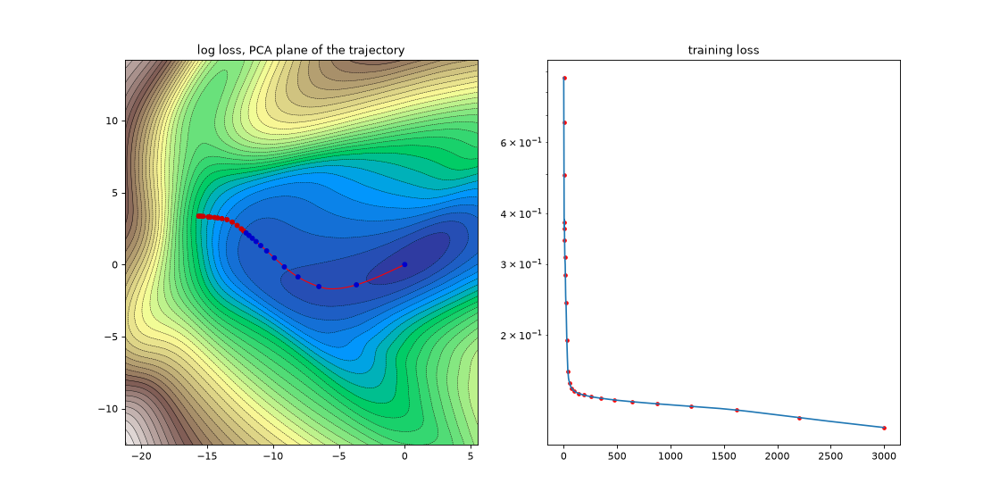
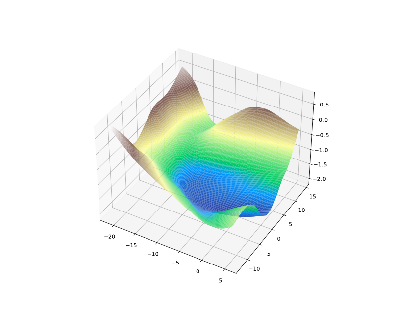

# The Descent: plan for the AI Journey website

AI & Data Science Cell · ENSIA Tech Community · drafted 2026-10-10

> **Update 2026-10-10: built on the club design system.** The base design system now comes from etclub.online (see `design-system/README.md`, specimen at `design-system/index.html`). The club site is already an ocean (abyss, deep, trench, foam, with a depth rail starting at "0 M · Surface"), so the concept became a **dive**: the paper topographic map turned into a **bathymetric chart** in the club's dark palette, where loss is depth. Wherever this plan says map, contour, camp, cairn, benchmark or spring, read chart, isobath, station, ping, sounding or kit. The light paper look survives as the "chart paper" theme for print and the poster. §2 and §4 below are updated; the rest of the plan stands.

> **Status 2026-10-10: built and live** at <https://almajd3713.github.io/ai-journey/> (repository `almajd3713/ai-journey`, deployed by GitHub Pages on every push to `main`). Build order steps 1–4 are done, with most of step 5 and part of step 6. What changed from this plan while building:
> - **Terrain:** basic Session 6's XOR network (2-4-1, 17 parameters), reproduced exactly from the notebook (losses 0.760, 0.025, 0.00229). The top two directions hold 99.9% of the path. The fine valley grid was dropped because the surface near the minimum has no extra structure.
> - **Hosting:** GitHub Pages rather than Vercel, so that deploys need only the repository. The workflow re-extracts the content (and fails if it is stale), checks the markers, builds the kit with nbconvert, and builds the site. The domain `journey.etclub.online` waits for a DNS record (see `README.md`).
> - **Scroll:** native scroll with a damped camera, so no Lenis. Stations are reached when a card's middle crosses the middle of the screen.
> - **Markers:** `content/markers.json` (not YAML) holds one sounding and one ping per station. `tools/check_markers.py` checks every number against the notebook's text and outputs.
> - **Advanced course:** download and read only, no Colab link, because these notebooks are read from their saved outputs (decision from the course plan, 2026-10-10).
> - **Instructor guides** (`INSTRUCTOR_GUIDE.md`) are not in the public repository or the kit until decided (§11, item 3).
> - Not built yet: free roam / drop a learner, "where do I start?", OG cards, the poster, and the additions in §13.
> - **Implementation notes, R3F 9.8:** the app runs without `<StrictMode>`; shader materials are constructed with `new THREE.ShaderMaterial(...)` so uniform updates reach them; the 2D charts use CPU-backed canvases (`willReadFrequently`), because GPU-backed ones delayed WebGL context creation by 20–45 s in testing; weak GPUs fall back from 3D to 2D unless the visitor chose 3D.

## 1. The idea in one paragraph

The site is a **map of a real loss landscape**, and the two courses are a trail down it. Every session is a camp. Scrolling is taking training steps: the camera walks downhill, an altimeter shows the loss falling, and the basic course covers the steep upper slopes, while the advanced course follows the long valley floor where the fine structure is. The ground itself is not invented. It is the measured loss surface of a small network, drawn the way Li et al. (2018) draw one, with the network's own training run as the trail. The site practises what the courses teach: learning is going downhill one small step at a time, and every number shown comes from a real run.

Working title: **AI Journey: The Descent**. Subdomain: `journey.etclub.online` is recommended (see §11).

## 2. How it differs from the sibling site

| | ScaleUp (sibling) | The Descent (ours) |
|---|---|---|
| Metaphor | A building: cube → corridor → rooms | The ocean floor: chart → seafloor → dive |
| Story | One app grows from 50 users to 2M | One model's loss falls from high to converged |
| Look | Its own palette (navy, mint/cyan), bloom, Azonix + IBM Plex | The **club's own** design system (abyss, signal→cyan, Azonix + Archivo + JetBrains Mono), with sonar-like isobaths and depth tints; no bloom. A light "chart paper" theme for print |
| Motion | Walk forward through rooms | Dive: a flat chart lifts into 3D seafloor, then the camera descends along the trail |
| Data | Illustrative user numbers | Real loss surface and real training trajectory |
| End | A letter from the instructor | "Converged?" A checkpoint, the guides, the field kit (downloads) |
| Stack | React, React Three Fiber (R3F), drei, postprocessing | The same core (so the club shares one skill set) but no postprocessing and lighter by design |

## 3. The ground is real (the core innovation)

The terrain comes from a real training run. A test run is already done (`tools/landscape_spike.py`):

1. Train a small network and save its weights at every step.
2. Do PCA on the trajectory (each saved weight vector minus the final weights). The top two directions explained **99.0%** of the trajectory's variance in the test run.
3. Evaluate the true training loss on a 129×129 grid in that plane, centred on the final weights.
4. Project the trajectory onto the plane. That projection is the trail.





The result already has the qualities a map needs: a high shoulder to start from, ridges on two sides, a curving valley and a basin. The waypoints in the picture are log-spaced and bunch at the start. In the real build, **camps are spaced by arc length** along the trail.

### Decisions for the real build
- **Which network:** use the Session 6 network on its own data, so the visitor can be told "you are walking down the loss surface of the network you train in Session 6". The test used two moons as a stand-in.
- **Height:** log of the loss, so the contour interval is constant in log-loss. Index contours are labelled with real loss values (`0.42`, `0.18`…).
- **Trail height vs. altimeter:** the checkpoints are not exactly on the plane, so the trail is drawn on the surface (the loss of the projected point), while the altimeter shows the **true training loss of that checkpoint**. Both are honest; the "How this map was made" note explains the difference.
- **Valley detail:** compute a second, finer grid (257²) around the minimum. As the advanced route reaches the valley floor, the terrain switches to it, so the fine structure appears exactly where the advanced course is about details. Level of detail becomes part of the story.
- **Course split:** 27 camps. Basic sessions 0–12 sit on the steep part, where most of the loss falls. Advanced sessions 0–13 sit on the flat valley floor, where progress is slow and careful. The loss curve itself tells the story of the two courses.
- **Seeded and reproducible:** the script, seed and package versions go in `public/terrain/meta.json`, like the course's own run records.

## 4. The map language

> **Superseded by `design-system/`.** The visual system is now the club's: the colours, type and components are in `design-system/tokens.css`, `base.css` and `components.css`. The cartographic ideas below still apply, drawn as a sea chart: isobaths lit Tanaka-style, index isobaths labelled with loss, a depth gauge instead of an altimeter, and the gradient rose. The basic route is drawn in `signal` and the advanced route in `cyan`, so the journey runs along the club gradient. The palette and type in this section are replaced; use the README there.

The visual system is cartography, not sci-fi. References: Eduard Imhof's Swiss relief style (colour modulated by height and light, more contrast on peaks, haze in valleys), Tanaka's illuminated contours (lighter on lit slopes, darker in shadow, thickness varying with slope direction), and San Rita's topographic studio site as proof the genre works on the web.

| Map convention | Our version |
|---|---|
| North arrow | **Gradient rose**: always points to −∇L (downhill) from the camera's position |
| Scale bar | "1 camp = 1 session = 60 min" (90 for advanced 3 and 5) |
| Elevation | Loss; an altimeter in the corner shows `step · loss · learning rate` |
| Legend | ⛺ camp = session · ▲ cairn = pause question · ◉ benchmark = a measured number · ≈ spring = downloads · ⌒ saddle = the pass between the courses |
| Cartouche (title block) | Course, edition, cell, club, and **"Guides"**, listing the instructors (data-driven, see §7) |
| Trails | Vermilion for the basic route and ultramarine for the advanced route; dotted threads for links between the courses |
| Survey notes | "How this map was made": the method, the seed, and what the projection does and doesn't show |

**Palette (paper map)**: paper `#F3EEE2`, ink `#2B2A26`, contour sepia `#8A6F4E`, slope ochre `#C9B48A`, valley sage `#7FA08A`, basin teal `#3E6B6B`, trail vermilion `#D9481C`, advanced ultramarine `#2F4B9A`.
**Night map (dark theme)**: paper `#141A22`, contours pale sand, trail colours lifted for contrast. The sibling site is dark only; offering both themes is a difference in itself.

**Type**: Fraunces (italic for place names, like hand-lettered maps), Inter Tight for body text, JetBrains Mono for the altimeter and numbers. All three are OFL-licensed, self-hosted through `@fontsource`. IBM Plex is deliberately avoided because the sibling site uses it.

## 5. The journey, scene by scene

**Prologue: the sheet.** An orthographic, top-down printed map lying flat, with the cartouche, the legend, and the trail drawn but faded. The altimeter reads `step 0 · loss 0.87 · the machine knows nothing yet`. Two buttons: **Begin the descent** and **Read the map** (the 2D index).

**Lift-off (the signature transition).** On the first scroll, the flat contours rise into 3D relief. A single `uLift` value in the terrain shader goes from 0 to 1 while the camera tilts from overhead to a walker's view. This replaces the sibling's "click the cube" with something only this concept can do.

**Act I: the basic route (camps 0–12).** The camera follows the vermilion trail down the steep slope, and the trail draws itself as you advance. At each camp a card slides in:
- title, one-line description, and the three "by the end you should be able to" outcomes
- a **benchmark**: one real measured number from the notebook ("a leaked column gives a perfect score", "a model that scores 99% and is useless")
- a **cairn**: one of the session's real pause questions, as *Guess before you see* (see §6)
- **spring**: its downloads

**The saddle.** At the pass between basic Session 12 and advanced Session 0, the view opens onto the valley. A stamp reads: `checkpoint saved: basic.pt`. This is where a reader of the advanced course "resumes training".

**Act II: the advanced route (camps 0–13).** The camera drops lower and the route turns ultramarine. Imhof haze thickens, steps get shorter, and the fine-grid terrain fades in. **Threads** appear: dotted arcs linking camps across the two courses where the connection is real:
- advanced 13 ↔ basic 9: CLIP on the same flower photos
- advanced 8 ↔ the basic course: its retrieval corpus is the basic course's own text
- advanced 0 ↔ basic 12, advanced 1 ↔ basic 11

They are labelled *low-loss paths*, a nod to mode connectivity (Garipov et al. 2018): separately found minima are joined by paths along which the loss stays low.

**Epilogue: "Converged?"** The trail reaches the basin. The text says that a minimum is a checkpoint, not an ending. Then come the **Guides** (instructors), the **Field kit** (all downloads), the **Provisions** (what the notebooks download, and hardware and run times, from the READMEs), and **How this map was made**.

**Free roam: "Explore the map".** Available at any time from the header. The camera becomes an orbit view, and clicking anywhere on the terrain drops a learner (a small ball leaving footprints) that descends. Controls are an optimizer (SGD / momentum / Adam) and a learning-rate slider. With too large a rate the ball bounces out of the valley, which is basic Session 7 as a toy. The note is honest: the ball runs on this 2D slice, not on the full network.

## 6. Interactions, by priority

**Must have**
1. Scroll-driven descent with camp cards, plus keyboard navigation (← → camp to camp, Esc, Home) and deep links (`#basic-06`, `#advanced-13`) that fly the camera to a camp.
2. **Downloads** at every camp and in the Field kit (§8).
3. **2D map mode.** The same data drawn as SVG contours. It is used for `prefers-reduced-motion`, no WebGL, low-power devices and no-JS, and it is the "Read the map" index. Content and downloads must never depend on WebGL.
4. Altimeter and gradient rose.

**Should have**

5. **Guess before you see.** Each cairn shows a real pause question from the notebook with two to four choices. The visitor picks one, then the measured answer appears with its number, including the cases where the fancier method lost. This is the courses' own teaching format.
6. **Drop a learner** (free roam).
7. **Your trail.** Camps you have visited get stamped (kept in `localStorage`, fine to lose), and the cartouche shows "camps visited: 9 / 27".
8. **Where do I start?** Three questions place the visitor at basic 0 or advanced 0, and the camera flies there.

**Could have**

9. **Printable poster.** The 2D map is exported at build time as an A2 PDF for the cell's wall, with a QR code to the site.
10. Per-session share images (OG cards) generated at build time: the map cropped around that camp.
11. Ambient sound (wind, footsteps), off by default.

## 7. Content model

All text is data, not code, so new sessions, editions and **instructors** are added by editing files.

```
content/
  site.json          club, cell, course title, edition, subdomain, theme defaults
  people.json        instructors (any number)
  courses/basic.json     course metadata + sessions[]
  courses/advanced.json
  markers.yaml       hand-curated benchmark numbers and pause questions, each with its source
```

```jsonc
// people.json
[
  {
    "id": "redhouane-lazib",
    "name": "Redhouane Lazib",
    "role": "Lead instructor",
    "courses": ["basic", "advanced"],   // or omit for all
    "sessions": null,                    // or ["advanced-06", ...] for a guest guide
    "photo": null,                       // falls back to a monogram stamp
    "bio": "",
    "links": {}
  }
]
```

```jsonc
// one session in courses/basic.json
{
  "id": "basic-06",
  "n": 6,
  "title": "From a Linear Model to a Neural Network",
  "minutes": 60,
  "summary": "...",                      // extracted from the notebook's title cell
  "outcomes": ["...", "...", "..."],     // extracted from "By the end of the session"
  "guides": null,                         // null = course default from people.json
  "notebook": "session_06_neural_networks.ipynb",
  "threads": [],                          // ids of linked camps in the other course
  "hardware": { "device": "CPU", "time": "about 20 s" }
}
```

- `tools/extract_content.py` reads each notebook's title cell (title, summary, outcomes) and the README tables (hardware, downloads), so the site never drifts from the notebooks.
- `markers.yaml` holds the benchmark numbers and pause questions. Each entry records the notebook and cell it came from. A check script (in the spirit of `_build/checknums.py`) fails the build if a quoted number is not in that cell's saved output.
- Instructors appear in the cartouche, on any camp they lead (`sessions`), and in the Guides section. Adding a second instructor means adding one object to `people.json`.
- Strings are kept in one place so a French or Arabic version can be added later (§11).

## 8. Downloads ("Field kit")

Per session:
- **Notebook** `.ipynb` with saved outputs, the primary download. Sizes are 44 KB–1.2 MB; the largest is advanced 13 at 3.8 MB.
- **Read in the browser:** an HTML render made with `nbconvert` at build time, so every session can be read on a phone with no setup.
- **Open in Colab:** `https://colab.research.google.com/github/<org>/<repo>/blob/main/<path>.ipynb`. This only works if the notebooks are in a **public GitHub repo**.

Per course:
- a **zip** with all notebooks, `README.md`, `requirements.txt`, and for the advanced course `aij_common.py`, `tinygpt.py` and `data/` (148 KB)
- `requirements.txt` on its own
- the **Instructor guide**: whether to publish it is your decision (§11)

Excluded: the advanced course's `cache/` (348 MB). The notebooks rebuild it, and the Provisions section says so with the run times.

All files are generated by `tools/build_downloads.py` into `public/kit/` with sizes and SHA-256 checksums in a manifest that the site reads. That manifest lets the site show file sizes and a "last updated" date. The whole kit is about 15–20 MB, far below Vercel Hobby's 100 MB per-file static limit. `vercel.json` serves `.ipynb` and `.zip` with `Content-Disposition: attachment`.

## 9. Implementation

### Stack
- **Vite + React + TypeScript**, **three.js** through **React Three Fiber** and **drei**: the same as the sibling site, so knowledge and components can be shared across the club.
- **WebGL2 renderer, not WebGPU.** The terrain is one custom GLSL shader. The WebGPU renderer in R3F v9 still needs an async setup and doesn't run raw GLSL, and Firefox support varies by platform. Revisit later; nothing here needs compute shaders.
- **Lenis** for smooth scrolling as the **single scroll source**. Don't mix it with drei's `ScrollControls` or GSAP ScrollTrigger scrubbing, which desync. GSAP is used only for one-off tweens, such as the deep-link fly-to.
- No postprocessing pass. The paper grain and Imhof haze happen in the terrain shader, and a CSS vignette handles the page edge.

### Scene
| Element | How |
|---|---|
| Terrain | `PlaneGeometry` (256² segments on desktop, 128² on mobile). The vertex shader displaces it from a float heightmap `DataTexture` scaled by `uLift`, which also drives the flat-to-3D morph. |
| Terrain look | Fragment shader: hypsometric tint from a 1D colour ramp texture, hillshade from heightmap normals, **Tanaka contours** (`fract(h / interval)` with `fwidth` anti-aliasing, line brightness from `dot(normal, light)`, every fifth contour heavier), paper grain noise, and Imhof aerial haze by distance and height. |
| Fine valley grid | A second heightmap blended in by distance to the minimum and scroll progress. |
| Trail | A drei `<Line>` along the smoothed trajectory, with a `uProgress` value that reveals the trail as you go. One colour per course. |
| Camps, cairns, benchmarks | Instanced low-poly meshes built in code (a tent, a stone stack, a survey pin), so no model files are needed. |
| Map labels | troika text (`drei <Text>`) laid flat on the terrain: place names, contour values, the saddle. |
| Camp cards | DOM overlay, not WebGL, so the text is accessible and selectable, and search engines can read it. |
| Camera rig | `CatmullRomCurve3` through the camp positions (lifted above the ground), sampled at the scroll progress. Position and look-at target are both damped, and the camera looks a few percent ahead along the curve. |
| Free roam | drei `OrbitControls` with a clamped tilt. Raycasting onto the terrain picks the drop point. The learner's gradient descent runs on the CPU from finite differences of the heightmap, with a drei `<Trail>` behind it. |
| Gradient rose | Bilinear gradient of the heightmap at the camera's ground point, drawn as a DOM/SVG compass. |

### Performance and accessibility
- The 3D scene is a lazy-loaded chunk. The first paint is the SVG map plus the DOM content, so the page is usable before WebGL loads.
- Device pixel ratio is clamped to [1, 1.75], and drei's `PerformanceMonitor` steps detail down on weak GPUs.
- Budget: initial JS under 150 KB gzip and the 3D chunk under 450 KB gzip. The sibling ships about 1.1 MB unminified in one main bundle.
- `prefers-reduced-motion` means 2D map mode with jump navigation and no camera flights. All controls are keyboard-reachable, and the canvas is `aria-hidden` because everything in it is also in the DOM.

### Repository layout
```
website/
  PLAN.md
  content/            site.json, people.json, courses/*.json, markers.yaml
  tools/              Python (course venv): make_landscape.py, extract_content.py,
                      build_downloads.py, check_markers.py, make_poster.py
  public/
    terrain/          height.f32, height_fine.f32, trajectory.json, meta.json
    map/              contours.svg (2D mode), poster-a2.pdf
    kit/              notebooks, HTML renders, zips, manifest.json
    fonts/, icons/, og/, etc-logo.png
  src/
    App.tsx, content.ts (typed loader)
    scene/            Terrain.tsx, terrain.glsl, Trail.tsx, Camps.tsx, CameraRig.tsx,
                      Learner.tsx, Labels.tsx
    ui/               Altimeter, GradientRose, CampCard, GuessCard, Cartouche,
                      FieldKit, Guides, MapMode2D, Legend
  vercel.json
```

### Build pipeline
```
python tools/make_landscape.py     # trains, saves the trajectory, evaluates both grids → public/terrain
python tools/extract_content.py    # notebooks + READMEs → content/courses/*.json
python tools/check_markers.py      # every quoted number is in its cell's saved output
python tools/build_downloads.py    # copies, nbconvert renders, zips, manifest
npm run build                      # vite → dist/
```
The terrain and the downloads are committed outputs, so a Vercel deploy only runs `npm run build`. Python is never needed on Vercel.

## 10. Assets

| Asset | Source | Format | Budget |
|---|---|---|---|
| Heightmaps (coarse and fine) | `make_landscape.py` | Float32 binary + JSON metadata | ~65 KB + ~260 KB |
| Trajectory and camp positions | `make_landscape.py` | JSON | < 50 KB |
| 2D contour map | built from the heightmap (d3-contour or matplotlib) | SVG | < 200 KB |
| Colour ramps (paper and night) | designed | 256×1 PNG | 1 KB each |
| Icon set: camp, cairn, benchmark, spring, saddle, compass, download, Colab | drawn for the site, hand-inked style | SVG sprite | < 20 KB |
| 3D markers | procedural in code | none | 0 |
| Fonts: Azonix (club OTF), Archivo (variable, width axis), JetBrains Mono | club file + Google Fonts / @fontsource | OTF/WOFF2 | < 150 KB |
| Club brand files: emblem, wordmark, ENSIA logo, icons, mascots | etclub.online, in `design-system/assets/club/` | WebP/SVG | as provided; ask the club for an SVG emblem |
| Favicon / app icon | a contour-ring mark with a trail dot | SVG + PNG | small |
| Instructor photos | optional; monogram stamp fallback | WebP | < 60 KB each |
| OG share cards | generated at build time per session | PNG 1200×630 | < 120 KB each |
| Notebooks, HTML renders, zips | `build_downloads.py` | ipynb / html / zip | ~15–20 MB total |
| Poster | `make_poster.py` | PDF (A2) | < 5 MB |

No commissioned 3D models, photographs or video are needed. Every visual comes from the data or from code, which keeps the site honest and easy to maintain.

## 11. Decisions

1. **Subdomain:** `journey.etclub.online` (decided 2026-10-10). Needs the club's DNS: a `CNAME journey → almajd3713.github.io`.
2. **Public GitHub repo:** yes, `almajd3713/ai-journey` (created 2026-10-10). It holds the two third-edition course folders (without `_build/`, `cache/` or the instructor guides) and the website.
3. **Instructor guides:** still open. Not published until decided.
4. **Languages:** English only. The French and Arabic glossary was dropped in the course plan.
5. **Terrain network:** Session 6's (done).
6. **Instructors:** Redhouane Lazib leads; more will be added. `content/people.json` takes any number, and two "to be announced" slots show meanwhile.
7. **Unit name:** "AI & Data Science Cell", as on etclub.online.

## 12. Build order

1. **Data first:** `make_landscape.py` on the Session 6 network, check the map visually, then generate both grids and the trajectory.
2. **Content and kit:** extraction, `markers.yaml`, downloads and manifest. The 2D map mode ships here, as a usable site with every download, before any 3D.
3. **Terrain shader:** Tanaka contours, Imhof tints, paper grain, both themes, and the lift transition.
4. **The descent:** camera rig, trail reveal, camps, cards, saddle, threads, altimeter, gradient rose, deep links.
5. **Interactions:** Guess before you see, free roam with Drop a learner, your trail, Where do I start.
6. **Polish:** performance pass, accessibility pass, OG cards, poster, Vercel and subdomain.

## 13. Planned additions from the course enhancement plan

Source: `../ENHANCEMENT_PLAN.md` (§5–7, §9, §11), written 2026-10-10 by the session working on the courses. None of this material exists yet; it will be generated into the course folders, and the site picks it up then. The same rules apply: content comes from the notebooks, every quoted number is checked against outputs, and every page works without WebGL.

**New downloads in the field kit.** All of these go through `build_downloads.py` with sizes and checksums, like the notebooks:
- `exercises/bNN_your_turn.ipynb` and `aNN_your_turn.ipynb` per session, shipped without outputs, with `aij_check.py`. **Solutions are public downloads** (user decision 2026-10-10).
- Two bug-hunt notebooks (basic, advanced), each with an answer key.
- Two capstone briefs with rubrics: basic, a full experiment report; advanced, reproducing a paper claim.
- Two printable cheat sheets (PDF): the basic experiment checklist, and the advanced "transformer at a glance".

The kit section gets a third block, "Practice", and each station links its exercise. The advanced exercises don't depend on `cache/`, so it stays out of the kit.

**Data the site will read** (one source for the notebooks and the site). Updated 2026-10-10: these live in a published `site/` folder in each course (`<course>/site/figures.json`, `figures/*.png`, `pauses.json`, `explorables/<id>.json`, `warmups.json`), so the repository whitelist needs no change. The course session sends entries for `content/wrecks.json` (claim, number, notebook, cell), and the site keeps that file. Exact schemas will follow. Any change to the pause format that `extract_content.py` reads is agreed first.
- `site/pauses.json` per course: every pause question with 2–4 choices, the measured answer and its cell. It replaces the hand-written pings in `content/markers.json`. `check_markers.py` reads it and checks the answers against the outputs, and every pause becomes available, not one per station.
- `site/figures.json` per course: each new figure with session, anchor cell, caption, alt text and the numbers it shows with their source cells. The ★ figures go on the station cards. The figures are embedded in the notebooks, so the nbconvert reads in the kit show them too; the course plan's rendering spike checks this.
- `content/wrecks.json`: a **"Wrecks on the seabed"** gallery of the courses' instructive failures, each with its number and cell. Examples: the hand-written rule beats the model (0.947 against 0.921); the leaked column scores 1.000; the 0.5B judge picks the first answer 97.9% of the time. It is drawn as wrecks on the chart, plus a list. `check_markers.py` checks it.
- **Precomputed grids for explorables** (kernel-free sliders, every value measured): B04 threshold, B06 descent path, B07 learning rate and L2, B03 k-NN k, A01 d_k, A03 temperature / top-p, A05 compute budget, A09 batch size (from saved outputs), A11 false discoveries. Each sits on its station card. B06's slider can drive the dive itself, since the terrain is its loss surface.
- `site/warmups.json`: warm-up questions per session (the instructor guides aren't published), shown on the station cards.
- An English-only **glossary and concept map**, built from the bolded definitions in the notebooks, as a page linking terms to the stations that define and use them.

**Callbacks** between the courses become more currents in `markers.json`: B04 → A10–A11, and B10–B11 → A00–A01.

**Not on the site:** running notebooks in the browser. JupyterLite was dropped (decision 6): the site only provides files.

## Sources
- Li et al., *Visualizing the Loss Landscape of Neural Nets*, NeurIPS 2018: https://arxiv.org/abs/1712.09913
- Garipov et al., *Loss Surfaces, Mode Connectivity, and Fast Ensembling of DNNs*, NeurIPS 2018: https://arxiv.org/abs/1802.10026
- Javier Ideami's loss-landscape visualisations (art from real training runs): https://wandb.ai/wandb_fc/events/reports/Salon-with-Javier-Ideami--Vmlldzo2MjI3MDg
- Gabriel Goh, *Why Momentum Really Works*, Distill 2017: https://mlanthology.org/distill/2017/goh2017distill-momentum
- Terrain cartography: hillshading, hypsometric tints, Tanaka contours: https://en.wikipedia.org/wiki/Terrain_cartography
- Jenny & Hurni, Swiss-style colour relief shading: https://mail.colororacle.org/berniejenny/pdf/2006_JennyHurni_SwissStyleShading.pdf
- Tanaka contours in practice (R package, QGIS style): https://cran.ma.imperial.ac.uk/web/packages/tanaka/index.html, https://hub.qgis.org/styles/68/
- San Rita's topographic portfolio (R3F + GSAP + Lenis): https://www.abduzeedo.com/san-ritas-topographic-web-design-navigates-projects-terrain
- Contour-map scroll timeline technique: https://dev.to/vitorstick/how-i-built-a-timeline-portfolio-using-canvas-2d-4a26
- Scroll-driven camera paths: https://tympanus.net/codrops/2025/11/19/how-to-build-cinematic-3d-scroll-experiences-with-gsap/ and https://github.com/Tunaycel/portfolio
- R3F v9 and WebGPU: https://r3f.docs.pmnd.rs/tutorials/v9-migration-guide, https://threejs.org/manual/en/webgpurenderer
- `fwidth` in three.js shaders: https://discourse.threejs.org/t/fwidth-no-matching-overloaded-function-found/24436
- Vercel limits: https://vercel.com/docs/limits
- Open in Colab link format: https://github.com/OpenMDAO/RevHack2020/blob/master/usingColab.md
